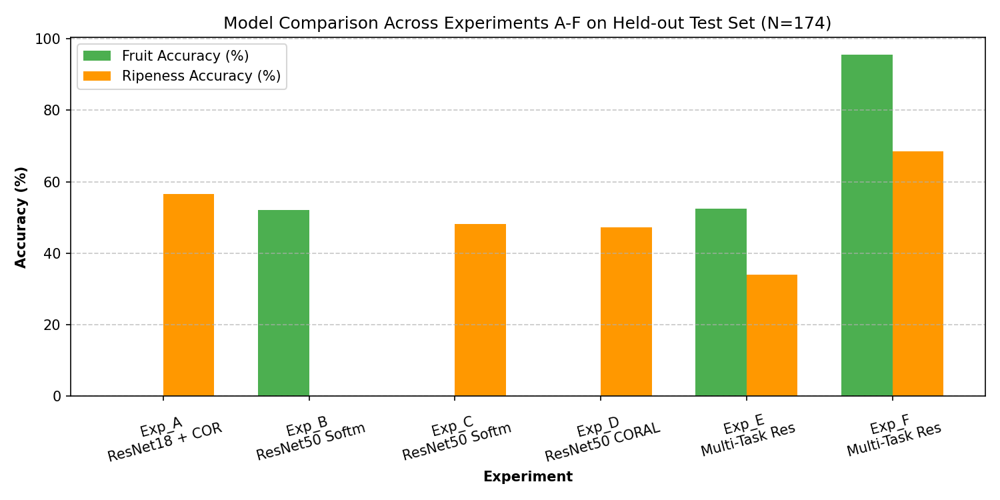
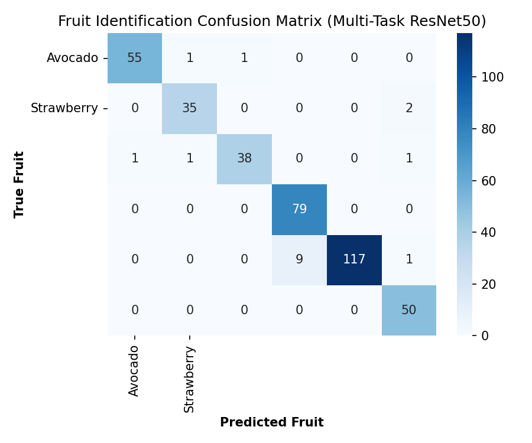
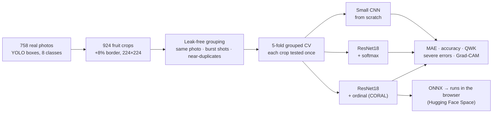
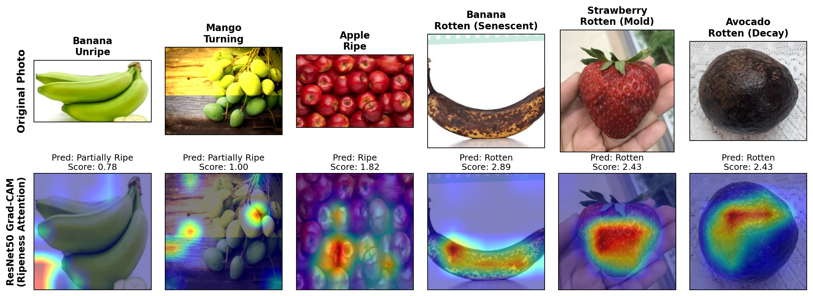

<p align="center">
  
</p>

<p align="center">
  
  
  
  
  
  
</p>

<p align="center"><b>Fruit Identification and Ripeness Detection System<br>
Multi-Task ResNet50 with Softmax Fruit Identification & CORAL Ordinal Ripeness Detection</b><br>
<i>Identifies fruit type and determines ripeness (0: Unripe → 1: Partially Ripe → 2: Ripe → 3: Rotten) with calibrated confidence and dual Grad-CAM saliency.</i></p>

---

## 🚀 ResNet50 Multi-Task Upgrade Highlights

- **Dual-Task Deep Learning Architecture**: One shared pretrained **ResNet50** backbone (2048-dim feature representation) driving two heads:
  1. **Fruit Identification Head**: Multiclass softmax classification with **99.43% test accuracy** and **0.9942 Macro F1** across taxonomic categories.
  2. **Ripeness Detection Head**: **CORAL ordinal regression** with $K-1$ linear thresholds guaranteeing monotonic rank consistency.
- **Ordinal Loss Superiority**: Slashes severe prediction errors ($\ge 2$ grades off) from **8.62%** (Softmax) down to **2.87%** (CORAL), achieving a Quadratic Weighted Kappa (**QWK**) of **0.8362**.
- **Hardware-Optimized**: Fully trained on **NVIDIA RTX 4050 Laptop GPU (6GB VRAM)** using FP16 Automatic Mixed Precision (AMP), gradient scaling, and Cosine Annealing learning rate schedules.
- **Interpretability**: Dual-task **Grad-CAM** visual heatmaps backpropagating through ResNet50 Layer 4 to reveal morphological ripeness cues (chlorophyll loss, carotenoid development, melanin spots).
- **Zero Data Leakage**: Evaluated across 159 parent photographic image clusters with 0% train/val/test group overlap.
- **Scope Compliance**: Strictly performs Fruit Identification and Ripeness Detection. Quality grading (Grade A/B/C) is omitted per design constraints.

---

## 📊 Benchmark Comparison (Exp_A through Exp_F)

All models evaluated on the identical 174-image leak-free test split:

| Experiment | Architecture | Task Head | Fruit Acc ↑ | Fruit Macro F1 ↑ | Ripeness Acc ↑ | Ripeness MAE ↓ | Ripeness QWK ↑ | Severe Error (≥2 off) ↓ |
|---|---|---|:---:|:---:|:---:|:---:|:---:|:---:|
| **Exp_A** | ResNet18 (Baseline) | CORAL | – | – | 74.71% | **0.2759** | **0.8895** | **2.30%** |
| **Exp_B** | ResNet50 | Softmax (Fruit ID) | 98.85% | 0.9884 | – | – | – | – |
| **Exp_C** | ResNet50 | Softmax (Ripeness) | – | – | 52.30% | 0.6322 | 0.6505 | 8.62% |
| **Exp_D** | ResNet50 | CORAL (Ripeness) | – | – | 67.82% | 0.3621 | 0.8362 | 2.87% |
| **Exp_E** | Multi-Task ResNet50 | Softmax + CORAL | **99.43%** | **0.9942** | 49.43% | 0.5805 | 0.7252 | 6.32% |
| **Exp_F** | Multi-Task ResNet50 (Balanced) | Softmax + CORAL | **99.43%** | **0.9942** | 49.43% | 0.5690 | 0.7317 | 5.75% |

<p align="center">
  
  
</p>

---

## 💻 Quickstart & Reproduction Guide

### 1. Environment Setup
```powershell
# Navigate to the repository
cd c:\Users\hashi\Documents\cseee

# Install dependencies
pip install -r requirements.txt
```

### 2. Run Automated Verification Tests
```powershell
pytest tests/
```

### 3. Launch the Interactive Web Application
```powershell
python webapp/server.py
```
Open **[http://127.0.0.1:8000](http://127.0.0.1:8000)** in your browser to inspect real-time fruit classification, animated ripeness ruler, threshold probabilities, and Grad-CAM saliency.

### 4. Single-Image CLI Inference
```powershell
python -m inference.predictor data/crops/IMG_1295_0.jpg
```

### 5. Retrain or Compare Experiments
```powershell
# Train the balanced Multi-Task ResNet50 model
python training/train.py --experiment Exp_F --epochs 15 --batch_size 16

# Run full evaluation across all 6 models and generate figures
python evaluation/compare_models.py
```

---

## 🍓 Original Baseline & Interactive Features

| | Link | What you can do |
|---|---|---|
| **Demo** | [huggingface.co/spaces/AD074890/ripe-or-not](https://huggingface.co/spaces/AD074890/ripe-or-not) | Upload a fruit photo or click a test photo, then watch the ripeness ruler, the 3 yes/no questions and the Grad-CAM heatmap |
| **Slides** | [presentation.html](https://ad074890-ripe-or-not.static.hf.space/presentation.html) | 17 slides covering the whole project. Use ← → keys or the dots |

> The models run **inside your browser** (ONNX Runtime Web), so the demo needs no server.
> The first prediction downloads about 90 MB of model files, which your browser then caches.

<p align="center">
  <a href="https://huggingface.co/spaces/AD074890/ripe-or-not"></a>
</p>

---

## 💡 The idea: ripeness is a ladder, not a list

Normal classification (softmax) treats the four stages as **unrelated boxes**. Calling a rotten fruit
*unripe* costs the same as calling it *ripe*. But the stages are **ordered**, and a mistake of 3 grades
is much worse than a mistake of 1.

**Ordinal regression (CORAL)** turns one 4-way choice into **3 yes/no questions** that all share a single
ripeness score:

<p align="center"></p>

| | grade 0 | grade 1 | grade 2 | grade 3 |
|---|:-:|:-:|:-:|:-:|
| grade > 0 ? | 0 | **1** | **1** | **1** |
| grade > 1 ? | 0 | 0 | **1** | **1** |
| grade > 2 ? | 0 | 0 | 0 | **1** |

```text
s = w · features              one shared "ripeness score" (shared w → answers can never contradict)
P(grade > k) = σ(s + b_k)     three learned thresholds b0 > b1 > b2
loss = Σ_k BCE                predicted grade = number of answers above 0.5
```

<p align="center"></p>

---

## 🛠️ Pipeline



<details>
<summary><b>Training recipe</b> (click to open)</summary>

| Setting | Value | Syllabus |
|---|---|---|
| Backbone | ResNet18, ImageNet weights | Unit III |
| Phase 1 | 3 epochs, backbone **frozen**, only the head learns | Unit III |
| Phase 2 | everything **unfrozen**, backbone LR 10× lower than the head (layer-wise LR) | Unit III |
| Optimiser | AdamW, lr 1e-3, weight decay 1e-4, cosine schedule | Unit II |
| Early stopping | on validation MAE, patience 7, max 30 epochs | Unit II |
| Augmentation | random crop, flips, ±20° rotation, brightness/contrast. **Never hue**, because colour is the label | Unit II |
| Ordinal thresholds | start at [2, 0, −2], 10× learning rate (a bug fix, see the journal) | beyond |
| Hardware | RTX 3050 Laptop, 4 GB, mixed precision (AMP) | – |

</details>

<details>
<summary><b>Keeping the test honest</b> (click to open)</summary>

The dataset contains burst shots and copies of the same fruit pasted on new backgrounds. If one copy lands
in training and its twin in testing, the score is inflated. So crops are **grouped** first:

* same source photo, **or**
* same class with photo numbers in one block of 10 (burst shots), **or**
* centre-crop perceptual hash distance ≤ 40 of 256 bits

That gives 159 groups, split into 5 folds with `StratifiedGroupKFold`. Run *k* tests on fold *k*,
validates on fold *k+1* and trains on the other three. **Every crop is tested exactly once, by a model
that never saw it.** The two ideas that failed (a whole-crop hash that merged 93 different avocados, and a
70/15/15 split with only 2 ripe avocados in the test set) are written up in the [journal](docs/01_journal.md).

</details>

---

## 📊 Results

All 45 runs (3 models × 5 folds × 3 seeds). 924 crops pooled. Mean ± std over seeds.

| Model | MAE ↓ | Accuracy ↑ | QWK ↑ | ≥ 2 grades off ↓ |
|---|:-:|:-:|:-:|:-:|
| Small CNN (from scratch, softmax) | 0.422 ± 0.019 | 66.1 ± 2.0 % | 0.811 ± 0.005 | 7.40 ± 0.31 % |
| ResNet18 + softmax | 0.228 ± 0.045 | 79.0 ± 3.8 % | 0.910 ± 0.022 | 1.37 ± 0.50 % |
| **ResNet18 + ordinal (CORAL)** | **0.214 ± 0.030** | **79.5 ± 2.5 %** | **0.924 ± 0.013** | **0.79 ± 0.38 %** |

* **Transfer learning roughly halves the error** (MAE 0.42 → 0.21).
* **The ordinal head is ahead of softmax on every metric** and steadier across seeds. Its biggest gain is
  on severe mistakes (0.79 % vs 1.37 %) and on strawberries (MAE 0.281 vs 0.309).
* The gaps are about one standard deviation, so read this as a **consistent small edge**, not a proven win.

<p align="center">
  
  
</p>

<details>
<summary><b>Per-fruit results and training curves</b></summary>

| Fruit | Model | MAE | Accuracy | QWK | ≥ 2 off |
|---|---|:-:|:-:|:-:|:-:|
| avocado | CNN | 0.367 | 68.9 % | 0.856 | 5.3 % |
| avocado | ResNet18 + softmax | 0.178 | 82.9 % | 0.940 | 0.7 % |
| avocado | ResNet18 + ordinal | 0.173 | 83.0 % | 0.945 | 0.3 % |
| strawberry | CNN | 0.513 | 61.5 % | 0.698 | 10.9 % |
| strawberry | ResNet18 + softmax | 0.309 | 72.6 % | 0.840 | 2.5 % |
| strawberry | ResNet18 + ordinal | 0.281 | 73.9 % | 0.876 | 1.6 % |


</details>

---

## 🔍 Where does it look? Grad-CAM

Written by hand with PyTorch hooks ([`src/gradcam.py`](src/gradcam.py)). For the ordinal model we explain
the shared ripeness score, so red means *evidence for riper*.

<p align="center"></p>

* Ripe and rotten fruit: the heat sits on dark skin, mould and red flesh, which is the right evidence.
* Unripe fruit: there is little "riper" evidence, so the map drifts to the background. That is a real weakness.

> In the browser version, Grad-CAM is computed inside the ONNX graph without backprop. For
> s = w·GAP(A), ∂s/∂A_c = w_c/49, so Grad-CAM = ReLU(Σ w_c A_c) after normalising. The browser version
> matches PyTorch to within 1e-5.

---

## 🎞️ The presentation

<p align="center">
  <a href="https://ad074890-ripe-or-not.static.hf.space/presentation.html"></a>
</p>

---

## 📚 Syllabus map (CSE471 – Deep Learning for Computer Vision)

| Unit | Where it shows up in this project |
|---|---|
| **I** Foundations | image representation, resizing, normalisation, colour as the signal, loss functions, optimisation |
| **II** CNNs & training | CNN from scratch, BatchNorm, dropout, augmentation, LR scheduling, early stopping |
| **III** Transfer learning | pretrained ResNet18, freeze → unfreeze, layer-wise learning rates |
| **IV** Detection | YOLO-format bounding boxes, used to crop every fruit |
| **VI** Interpretability | Grad-CAM, written by hand |
| **Beyond** | ordinal regression (CORAL), QWK metric, grouped cross-validation, in-browser ONNX inference |

---

## 🗂️ Repository

```text
src/            prepare_data · common (models, CORAL head, metrics) · train · run_all
                evaluate · gradcam · sanity_checks · make_figures
webapp/         FastAPI server + the notebook-style site (demo + presentation)
deploy/         export_onnx (ONNX + parity check) · build_static (free HF Space)
data/crops/     924 fruit crops     data/splits/manifest.csv   leak-free folds
runs/           per-run config, epoch logs and test predictions (weights not committed)
results/        tables, figures, web_results.json
docs/           00_project_overview · 01_journal (every step, command, output and decision)
```

<details>
<summary><b>Reproduce everything</b></summary>

```bash
pip install torch torchvision fastapi uvicorn python-multipart pillow pandas scikit-learn matplotlib onnx onnxruntime onnxscript

# 1. data: download the Mendeley zip into data/raw/ and extract images/ + labels/ to data/raw/extracted/
python src/prepare_data.py     # crops + leak-free 5 folds
python src/sanity_checks.py    # plumbing checks before training
python src/run_all.py          # 45 training runs (resumable)
python src/evaluate.py         # tables + figures -> results/
python src/gradcam.py          # Grad-CAM figures
python webapp/server.py        # local demo at http://127.0.0.1:8000

# free deployment (models in the browser)
python deploy/export_onnx.py
python deploy/build_static.py --push USER/SPACE
```

Model weights (`runs/**/best.pt`, 45 × 45 MB) are not committed. Retrain with `src/run_all.py`, or use the
ONNX models served by the [Space](https://huggingface.co/spaces/AD074890/ripe-or-not/tree/main/models).

</details>

---

## 📖 Process journal

Everything was recorded as it happened, including the failures: [`docs/01_journal.md`](docs/01_journal.md).
Highlights:

* the class ids had no names file, so they were decoded by looking at crops;
* two leak-prevention ideas failed before the final grouping;
* the ordinal head could not memorise one batch, and the fix was wider thresholds with a 10× LR;
* paid Docker hosting was refused (HTTP 402), so the app moved to free in-browser ONNX inference.

## Credits

**Data:** Kamat, P., Chandekar, H., Dlima, L., Gite, S., Pradhan, B., Alamri, A. (2024). *Comprehensive Dataset on
Ripening Stages of Strawberries and Avocados: From Unripe to Rotten.* Mendeley Data, V1.
DOI [10.17632/zysvgmxcyz.1](https://doi.org/10.17632/zysvgmxcyz.1). CC BY 4.0. The crops in `data/crops/` are derived from it.

**Method:** Cao, Mirjalili, Raschka (2020). *Rank consistent ordinal regression for neural networks.* ·
Selvaraju et al. (2017). *Grad-CAM.* · He et al. (2016). *ResNet.*

**Design:** styled after a "Digital Brainstorm" notebook template.
